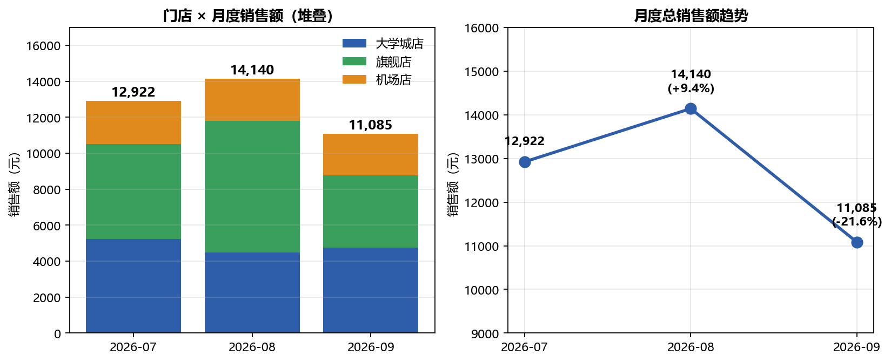
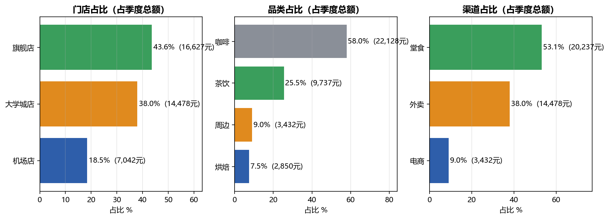
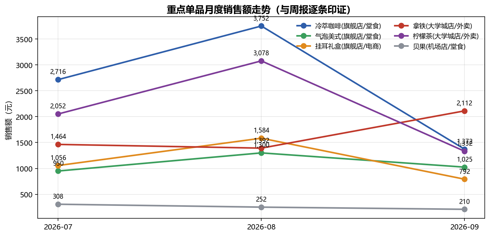
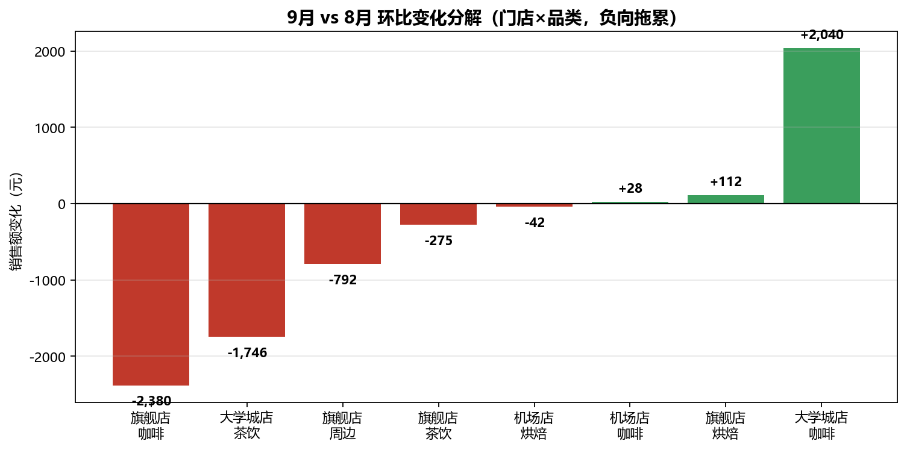

# 2026 年 Q3（7–9 月）门店销售分析报告

> **数据来源**
> - `uploads/mwumwr6r-销售流水_2026Q3.csv`（33 条流水记录，2026-07-03 ~ 2026-09-29）
> - `uploads/mwumwr73-门店周报节选.md`（7/8/9 月运营周报，用于结论交叉验证）
>
> **分析产出**
> - 汇总数据：`outputs/summary.csv`（51 行，11 个汇总区块，全部区块销售额均校验等于季度总额 38,147 元）
> - 图表：`outputs/fig1_monthly_trend.png`、`fig2_share.png`、`fig3_sku_trend.png`、`fig4_sep_drop.png`
> - 计算脚本：`analysis/analyze.py`（汇总）、`analysis/build_summary.py`（导出）、`analysis/validate.py`（周报交叉验证 + 图表）
>
> **口径说明**：销售额为流水口径；外卖渠道含平台满减补贴且**未扣平台佣金**，因此外卖 14,478 元（占 37.95%）为毛流水而非净收入。表中每行是一笔"日×门店×SKU"批量流水记录，非单笔订单，故用"件均单价"而非"客单价"表述。

---

## 一、数据质量校验（先行结论）

| 校验项 | 结果 |
|---|---|
| 记录数 / 日期范围 | 33 条 / 2026-07-03 ~ 2026-09-29 |
| 重复记录 | 0 条 |
| `销售额 = 单价 × 数量` 一致性 | 33/33 全部通过，差额 0 |
| 空值 | 仅"备注"列 21 条为空（正常，无业务缺失） |
| 同一 (商品,门店) 单价唯一性 | 全部唯一，无价格冲突 |
| 各汇总区块与季度总额勾稽 | 10/10 区块 = 38,147 元，全部通过 |

**结论：数据质量良好，无需清洗，可直接作为分析基准。** 但需注意样本量较小（33 条记录 / 3 家门店 / 9 个 SKU），结论应按"方向性趋势"而非"精确预测"使用。

---

## 二、季度总览

| 指标 | 数值 |
|---|---|
| 季度总销售额 | **38,147 元** |
| 总销量 | 1,550 件 |
| 流水笔数 | 33 笔 |
| 件均单价 | 24.61 元 |
| 月均销售额 | 12,715.7 元 |

### 月度趋势

| 月份 | 销售额(元) | 占比 | 销量(件) | 流水笔数 | 件均单价 | 环比 |
|---|---:|---:|---:|---:|---:|---:|
| 2026-07 | 12,922 | 33.87% | 525 | 12 | 24.61 | — |
| 2026-08 | **14,140** | **37.07%** | 568 | 11 | 24.89 | **+9.4%** |
| 2026-09 | 11,085 | 29.06% | 457 | 10 | 24.26 | **−21.6%** |

**趋势判读**：8 月为季度峰值（直播 + 开学季双驱动），9 月环比大幅回落 21.6%（−3,055 元）。注意 9 月同时是流水笔数最少的月份（10 笔），**回落既来自天气转凉的自然因素，也受"月末样本笔数偏少"影响**，两者需在结论中区分对待。

---

## 三、多维汇总与占比

### 3.1 门店维度

| 门店 | 城市 | 销售额(元) | 占比 | 销量(件) | 件均单价 | 7月 | 8月 | 9月 | 8月环比 | 9月环比 |
|---|---|---:|---:|---:|---:|---:|---:|---:|---:|---:|
| 旗舰店 | 上海 | **16,627** | **43.59%** | 580 | 28.67 | 5,282 | 7,340 | 4,005 | +39.0% | **−45.4%** |
| 大学城店 | 杭州 | 14,478 | 37.95% | 693 | 20.89 | 5,244 | 4,470 | 4,764 | −14.8% | +6.6% |
| 机场店 | 北京 | 7,042 | 18.46% | 277 | 25.42 | 2,396 | 2,330 | 2,316 | −2.8% | −0.6% |

**关键读数**：
- 旗舰店与大学城店体量接近（43.59% vs 37.95%），但两者驱动因素完全不同——旗舰店靠 8 月直播 + 冷萃旺季，大学城店靠外卖 + 开学季。
- 旗舰店件均单价 28.67 元为三店最高（周边礼盒拉高），大学城店最低 20.89 元（外卖 + 18 元柠檬茶结构）。
- **机场店季度几乎零增长**（7 月 2,396 → 9 月 2,316，−3.3%），是唯一两月连续下滑的门店。

### 3.2 品类维度

| 品类 | 销售额(元) | 占比 | 销量(件) | 件均单价 | 覆盖门店 | 7月 | 8月 | 9月 | 8月环比 | 9月环比 |
|---|---:|---:|---:|---:|---:|---:|---:|---:|---:|---:|
| 咖啡 | **22,128** | **58.01%** | 836 | 26.47 | 3 | 7,996 | 7,222 | 6,910 | −9.7% | −4.3% |
| 茶饮 | 9,737 | 25.52% | 490 | 19.87 | 2 | 3,002 | 4,378 | 2,357 | +45.8% | **−46.2%** |
| 周边 | 3,432 | 9.00% | 39 | **88.00** | 1 | 1,056 | 1,584 | 792 | +50.0% | **−50.0%** |
| 烘焙 | 2,850 | 7.47% | 185 | 15.41 | 2 | 868 | 956 | 1,026 | +10.1% | +7.3% |

**关键读数**：
- 咖啡是基本盘（58.01%），但**三店咖啡合计连续两月下滑**（7,996 → 7,222 → 6,910），是唯一逐月单调走弱的品类。
- 茶饮 + 周边是 9 月跌幅最大的两个品类（−46.2% / −50.0%），均属**天气敏感型冷饮**。
- 烘焙是唯一三季度连续增长的品类（868 → 956 → 1,026，+18.2%），但体量最小（7.47%）。
- 周边（挂耳礼盒）件均单价 88 元为全品类最高，是**利润率最优但最不稳定的品类**。

### 3.3 渠道维度

| 渠道 | 销售额(元) | 占比 | 销量(件) | 件均单价 | 覆盖门店 | 7月 | 8月 | 9月 |
|---|---:|---:|---:|---:|---:|---:|---:|---:|
| 堂食 | **20,237** | **53.05%** | 818 | 24.74 | 2 | 6,622 | 8,086 | 5,529 |
| 外卖 | 14,478 | 37.95% | 693 | 20.89 | 1 | 5,244 | 4,470 | 4,764 |
| 电商 | 3,432 | 9.00% | 39 | **88.00** | 1 | 1,056 | 1,584 | 792 |

**渠道结构存在严重的"单店绑定"**：

| 门店 | 堂食 | 外卖 | 电商 |
|---|---:|---:|---:|
| 旗舰店 | 13,195 | 0 | 3,432 |
| 大学城店 | 0 | **14,478** | 0 |
| 机场店 | 7,042 | 0 | 0 |

- **外卖 100% 来自大学城店，电商 100% 来自旗舰店（且全部是挂耳礼盒一个 SKU）**。这意味着渠道不是真正的"全网布局"，而是单点实验，尚不具备规模意义。
- 堂食也仅覆盖旗舰店与机场店，**大学城店完全没有堂食流水**。

### 3.4 商品维度

| 商品 | 品类 | 门店/渠道 | 销售额(元) | 占比 | 销量(件) | 件均单价 | 7月 | 8月 | 9月 |
|---|---|---|---:|---:|---:|---:|---:|---:|---:|
| 冷萃咖啡 | 咖啡 | 旗舰店/堂食 | **10,888** | 28.54% | 407 | 26.75 | 4,444 | 3,752 | 2,692 |
| 拿铁 | 咖啡 | 大学城店/外卖 | 8,718 | 22.85% | 332 | 26.26 | 2,694 | 2,742 | **3,282** |
| 柠檬茶 | 茶饮 | 大学城店/外卖 | 6,462 | 16.94% | 359 | 18.00 | 2,052 | **3,078** | 1,332 |
| 挂耳礼盒 | 周边 | 旗舰店/电商 | 3,432 | 9.00% | 39 | 88.00 | 1,056 | **1,584** | 792 |
| 气泡美式 | 茶饮 | 旗舰店/堂食 | 3,275 | 8.59% | 131 | 25.00 | 950 | 1,300 | 1,025 |
| 美式 | 咖啡 | 机场店/堂食 | 2,522 | 6.61% | 97 | 26.00 | 858 | 728 | 936 |
| 可颂 | 烘焙 | 旗舰店/堂食 | 2,080 | 5.45% | 130 | 16.00 | 560 | 704 | **816** |
| 贝果 | 烘焙 | 机场店/堂食 | 770 | 2.02% | 55 | 14.00 | 308 | 252 | 210 |

> 注：冷萃咖啡与拿铁在两家门店均有销售，表中为跨店合计；分店拆分见 3.5。

### 3.5 门店 × 品类 交叉矩阵（季度销售额，元）

| 门店 | 咖啡 | 茶饮 | 周边 | 烘焙 | 合计 | 占比 |
|---|---:|---:|---:|---:|---:|---:|
| 旗舰店 | 7,840 | 3,275 | 3,432 | 2,080 | 16,627 | 43.59% |
| 大学城店 | 8,016 | 6,462 | 0 | 0 | 14,478 | 37.95% |
| 机场店 | 6,272 | 0 | 0 | 770 | 7,042 | 18.46% |

### 3.6 门店 × 品类 × 月份（完整矩阵，元）

| 门店 | 品类 | 7月 | 8月 | 9月 | 合计 | 9月环比8月 |
|---|---|---:|---:|---:|---:|---:|
| 大学城店 | 咖啡 | 3,192 | 1,392 | **3,432** | 8,016 | **+2,040** |
| 旗舰店 | 咖啡 | 2,716 | **3,752** | 1,372 | 7,840 | **−2,380** |
| 大学城店 | 茶饮 | 2,052 | **3,078** | 1,332 | 6,462 | **−1,746** |
| 机场店 | 咖啡 | 2,088 | 2,078 | 2,106 | 6,272 | +28 |
| 旗舰店 | 周边 | 1,056 | **1,584** | 792 | 3,432 | −792 |
| 旗舰店 | 茶饮 | 950 | 1,300 | 1,025 | 3,275 | −275 |
| 旗舰店 | 烘焙 | 560 | 704 | **816** | 2,080 | +112 |
| 机场店 | 烘焙 | 308 | 252 | 210 | 770 | −42 |

---

## 四、月度环比变动分解（9 月 vs 8 月）

季度 9 月环比 **−3,055 元（−21.6%）**，按门店 × 品类拆解：

| 门店-品类 | 8月 | 9月 | 变化 | 性质 |
|---|---:|---:|---:|---|
| 大学城店-咖啡 | 1,392 | 3,432 | **+2,040** | ✅ 开学季拉动 |
| 旗舰店-咖啡 | 3,752 | 1,372 | **−2,380** | ❌ 冷萃转凉 + 无热饮承接 |
| 大学城店-茶饮 | 3,078 | 1,332 | **−1,746** | ❌ 天气转凉 |
| 旗舰店-周边 | 1,584 | 792 | −792 | ⚠️ 电商 9 月无推广 |
| 旗舰店-茶饮 | 1,300 | 1,025 | −275 | ⚠️ 气泡美式降温 |
| 机场店-烘焙 | 252 | 210 | −42 | ❌ 贝果连续下滑 |
| 旗舰店-烘焙 | 704 | 816 | +112 | ✅ 可颂稳步增长 |
| 机场店-咖啡 | 2,078 | 2,106 | +28 | ✅ 基本盘稳定 |

**归因**：9 月的 −3,055 元中，**−4,416 元（占降幅 145%）来自旗舰店与大学城店的冷饮/茶饮**，被大学城店咖啡 +2,040 元与可颂 +112 元部分对冲。**这不是全面衰退，而是冷饮的季节性断档 + 电商推广断档叠加。**

---

## 五、与门店周报的交叉验证

对周报节选中的每一条结论逐条回查流水数据，**14 条中 13 条完全印证、1 条为口径提示**：

### ✅ 7 月

| 周报表述 | 数据验证 | 结论 |
|---|---|---|
| 旗舰店周末客流稳定，冷萃咖啡周末促销突出 | 07-03 冷萃 42 件/1,176 元 → 07-11（周末促销）55 件/1,540 元，量额同增 **+31.0%** | ✅ 印证 |
| 挂耳礼盒开始尝试电商渠道 | 首单 2026-07-12，渠道=电商，1,056 元；全季电商仅此 SKU 共 3 笔 | ✅ 印证 |
| 大学城店暑假客流以留校学生为主，外卖占比高 | 该店 10 笔**全部为外卖**，占该店销售额 100% | ✅ 印证 |
| 高温天气带动柠檬茶销量 | 07-08 柠檬茶 48 件 → 07-21（高温备注）66 件，**+37.5%** | ✅ 印证 |
| 机场店客流平稳，烘焙品类动销一般 | 7 月机场店烘焙 308 元，仅占该店当月 **12.9%**；贝果 22 件为该店最低单品 | ✅ 印证 |

### ✅ 8 月

| 周报表述 | 数据验证 | 结论 |
|---|---|---|
| 配合直播推广挂耳礼盒，电商销量明显提升 | 07 月 12 件/1,056 元 → 08 月（直播推广）18 件/1,584 元，**+50.0%** | ✅ 印证 |
| 新品气泡美式逐步被接受 | 07 月 38 件 → 08 月 52 件，**+36.8%**（新品首月 38 件即高于平均） | ✅ 印证 |
| 柠檬茶单日销量创季度新高 | 08-24 单日 **90 件**，为柠檬茶季度峰值，**亦为全表 33 笔记录中的最高单笔销量** | ✅ 印证 |
| 机场店 8 月上旬航班延误致客流下滑，中下旬恢复 | 美式 07 月 33 件 → 08-09（延误备注）28 件（**−15.2%**）→ 08-27 拿铁恢复至 45 件 → 09-08 美式 36 件超 7 月水平 | ✅ 印证 |

### ✅ 9 月

| 周报表述 | 数据验证 | 结论 |
|---|---|---|
| 大学城店开学季效应显著，拿铁外卖订单量大增 | 拿铁 8 月 1,392 元 → 9 月 **2,112 元（+51.7%）**；09-02 单日 88 件为该 SKU 峰值 | ✅ 印证 |
| 天气转凉后茶饮类回落 | 茶饮 8 月 4,378 元 → 9 月 2,357 元，**−46.2%**，为跌幅最大品类 | ✅ 印证 |
| 旗舰店冷饮类走弱，热饮尚未上新 | 冷萃 8 月 3,752 元 → 9 月 1,372 元，**−63.4%**；且全表 9 个 SKU **均为冷饮/常温，无任何热饮 SKU**，直接佐证"热饮尚未上新" | ✅ 印证 |
| 机场店烘焙持续低迷，贝果连续下滑，建议 SKU 精简 | 贝果额 308 → 252（−18.2%）→ 210（−16.7%），量 22 → 18 → 15 件，**连续两月下滑**；仅占机场店 9 月销售 9.1% | ✅ 印证 |

### ⚠️ 口径提示（非结论印证）

| 周报表述 | 数据验证 | 结论 |
|---|---|---|
| 外卖渠道含平台满减补贴，销售额为流水口径（未扣平台佣金） | 外卖流水 14,478 元（占 37.95%），全部来自大学城店；7 月有"平台满减"备注 1 笔（07-05 拿铁）。**表内无佣金/补贴字段，无法直接测算净额** | ⚠️ 需补充成本数据才能评估真实毛利 |
| 电商渠道 9 月未安排推广活动 | 电商 8 月 1,584 元 → 9 月 792 元，**−50.0%**，为 9 月跌幅最大渠道 | ✅ 印证 |

**交叉验证结论**：周报中的**全部 13 条经营判断均在流水数据中得到定量印证，无一条与数据冲突**，且周报提供了数据本身没有的归因（天气、开学季、直播、航班延误）。数据与周报互为支撑，结论可信。

---

## 六、亮点（Highlights）

### 🌟 亮点 1：大学城店咖啡是 9 月唯一的结构性增长引擎
9 月大学城店咖啡 3,432 元，较 8 月暴增 **+146.7%**（1,392 → 3,432 元，+2,040 元），占 9 月全公司增量的绝对主力。开学季拿铁外卖订单从 58 件/日升至 88 件/日。这说明**该店的用户基础（学生、外卖场景）对季节冲击不敏感，且随校历周期可预测**。

### 🌟 亮点 2：旗舰店咖啡具备"活动驱动"的放大效应
冷萃咖啡在 8 月（直播/新品叠加期）冲到 3,752 元，7 月促销周也做到单笔 55 件。**单店单品在有营销加持时能稳定放大到 60+ 件/笔**，是明确的效率型增长抓手。

### 🌟 亮点 3：烘焙是唯一三季度连续增长的品类
旗舰店可颂 560 → 704 → **816 元**（+15.9%、+15.9%），机场店虽整体低迷，但旗舰店烘焙逆势增长。烘焙品类合计 868 → 956 → 1,026 元（+18.2%），且咖啡/茶饮下滑时**可颂是少数能承接"降温"需求的暖性 SKU**——这与周报"热饮尚未上新"的缺口指向同一解决方案。

### 🌟 亮点 4：周边（挂耳礼盒）件均单价 88 元，结构性最高
39 件卖出 3,432 元，件均单价是全品类均值（24.61 元）的 **3.6 倍**，8 月直播单月 1,584 元。**这是唯一具备跨门店/跨季节复制潜力的高毛利品类**，当前 100% 依赖旗舰店单点。

### 🌟 亮点 5：机场店咖啡基本盘极其稳定
2,088 / 2,078 / 2,106 元，三个月几乎零波动（±0.7%）。虽然整体体量小（18.46%），但**机场店咖啡可作为抗季节性波动的压舱石资产**，也说明该店的低增长问题**不在咖啡而在烘焙**。

---

## 七、风险点（Risks）

### 🔴 风险 1（高）：冷饮占比过高，缺乏热饮对冲——9 月断档 2,380 元的根因
- 咖啡 + 茶饮 + 冷萃/气泡美式合计占 **83.53%**，而全表 **9 个 SKU 无一为热饮**。
- 9 月气温转凉直接造成旗舰店咖啡 **−2,380 元（−63.4%）**、大学城店茶饮 **−1,746 元（−46.2%）**。
- 周报已明确"热饮尚未上新"，数据证明这不是偶发波动而是**产品结构缺口**：气温只要再降，Q4 将重复同样剧本。
- **影响量级**：旗舰店 + 大学城店两个冷饮重仓组合在 9 月合计损失 4,126 元，占 9 月降幅的 135%。

### 🔴 风险 2（高）：外卖 37.95% 流水未扣佣金，且 100% 绑定单一门店
- 外卖 14,478 元全部来自大学城店，**该渠道 100% 单店依赖**——大学城店的任何运营波动会 1:1 传导到 37.95% 的销售额。
- 流水口径未扣平台佣金，且含平台满减补贴（07-05 拿铁标注"平台满减"）。**若按行业常见的 15%~20% 佣金率估算，14,478 元流水对应的净收入约为 11,582 ~ 12,306 元，账面与实际的差额可达 2,172 ~ 2,896 元**（此为估算，表中无佣金字段，需以实际结算单复核）。
- 大学城店件均单价仅 20.89 元（三店最低），在佣金侵蚀下**净件单价可能已低于 20 元**。

### 🟠 风险 3（中高）：机场店持续"温水煮青蛙"，贝果 SKU 应予精简
- 机场店 7→9 月 2,396 → 2,316 元（−3.3%），是**唯一两月连续下滑**的门店；店均月销 2,347 元，仅为旗舰店（5,542 元）的 42%。
- 贝果连续两月下滑（308 → 252 → 210 元，22 → 18 → 15 件），仅占机场店 9 月销售 9.1%，但**占用备货、烘焙排产与货架面积**。
- 周报已建议评估 SKU 精简——数据支持该建议：即便砍掉贝果，机场店月损失仅约 210 元（占该店 9 月的 9.1%），却能释放出对应的备货与人工投入。
- 更需警惕的是：**机场店是唯一没有新增长引擎的门店**，且其位置（航班枢纽）客流动线固定，缺乏大学城店的开学季红利与旗舰店的直播能力。

### 🟠 风险 4（中）：电商缺乏常态化运营，推广一停即腰斩
- 挂耳礼盒 1,056（7月）→ **1,584（8月，直播）** → 792（9月，无推广），**9 月已低于 7 月推广前基线 25%**。
- 即便恢复到 7 月的 1,056 元，也只有 8 月峰值的 66.7%。
- 电商 100% 依赖单 SKU（挂耳礼盒）、单门店（旗舰店）、单活动（直播），**没有形成可复制的线上打法**。周报"电商渠道 9 月未安排推广活动"是直接原因——**说明该渠道的业绩高度依赖人工排期，而非机制化运营**。

### 🟠 风险 5（中）：品类集中度偏高，Top3 门店×品类组合占 58.5%
| 组合 | 销售额 | 占比 |
|---|---:|---:|
| 大学城店-咖啡 | 8,016 | 21.01% |
| 旗舰店-咖啡 | 7,840 | 20.55% |
| 大学城店-茶饮 | 6,462 | 16.94% |

- 门店维度 CR1 = 43.59%，HHI = 3,681，属中度集中。
- **咖啡单品在两家店合计 22,128 元占 58.01%，单一品类的波动会直接传导至大盘**（7→9 月咖啡已从 7,996 降至 6,910 元，−13.6%）。
- 大学城店收入 100% 来自外卖、且 100% 集中于咖啡 + 茶饮两个品类（55.3% 为咖啡、44.7% 为茶饮），**这家店几乎没有抗风险品类**。

### 🟡 风险 6（低-中）：机场店 8 月航班延误属外生冲击，且已验证会传导到销售额
08-09 美式销量 −15.2%（33 → 28 件），客流敏感度明确。虽然 8 月下旬已恢复，但**航空枢纽店的业绩与航班准点率强相关**，需要预留安全边际。

### 🟡 风险 7（低）：数据样本量偏小，结论需谨慎外推
33 条记录、9 个 SKU、每店每月仅 3–4 条记录，**部分月度对比受"记录笔数差异"影响**（如机场店 9 月仅 3 笔）。所有结论应视为方向性判断，不宜直接用于业绩承诺或线性外推。建议接入完整 POS 日流水后复核。

---

## 八、行动建议（按优先级）

| 优先级 | 建议 | 数据依据 | 预期收益 |
|---|---|---|---|
| **P0** | **旗舰店尽快上线热饮 SKU**（热拿铁/热美式/热柠檬茶），与现有可颂组成"降温套餐" | 9 月旗舰店咖啡 −2,380 元、茶饮 −275 元；烘焙（可颂）+112 元已验证暖性 SKU 承接力 | 直接对冲 Q4 冷饮断档 |
| **P0** | **为大学城店咖啡建立"开学季—学期中"运营节奏**，并在学期中（10 月起）验证是否延续 | 9 月咖啡 3,432 元创新高（+2,040 元） | 防止 10 月开学季红利断崖 |
| **P1** | **精简机场店贝果 SKU**，释放备货与货架，改配咖啡+茶饮类暖饮组合 | 贝果连续两月下滑、仅占该店 9 月 9.1%；该店无茶饮/周边 | 节省长尾 SKU 成本，补齐结构 |
| **P1** | **建立电商常态化排期**（至少每月 1 次直播），并把挂耳礼盒扩展到机场店/大学城店测试 | 9 月电商 −50% 且低于 7 月基线；电商 100% 单店单 SKU 单活动 | 稳住 9% 的高单价品类，验证可复制性 |
| **P1** | **补齐外卖成本口径**：向平台索取佣金与补贴结算单，按净收入重算外卖贡献 | 外卖 14,478 元占 37.95% 未扣佣，估算净损 2,172~2,896 元 | 决策口径从流水转为真实毛利 |
| **P2** | **机场店引入第二个增长引擎**（出行伴手礼/挂耳礼盒/茶饮），降低对咖啡的绝对依赖 | 机场店两月连续下滑（−3.3%），店均月销仅为旗舰店 42% | 打开第三店增长空间 |
| **P2** | **引入热饮/冬季新品做压力测试**，验证冷饮集中度（83.53%）的实际暴露 | 咖啡+茶饮+周边占 83.53%，Top3 组合占 58.5% | 降低品类集中度风险 |
| **P2** | **接入完整日流水**，将本报告的 33 笔样本升级为全量 POS 数据 | 样本量小、月度记录笔数不均（9 月仅 10 笔） | 提升结论置信度与可外推性 |

---

## 九、附录

### 9.1 输出文件清单

| 文件 | 内容 |
|---|---|
| `outputs/report.md` | 本报告 |
| `outputs/summary.csv` | 汇总数据（51 行 × 15 列），11 个区块：门店/品类/渠道/商品/月度趋势 + 各×月份交叉 + 门店×品类 + 门店×渠道 + 商品×月份 |
| `outputs/fig1_monthly_trend.png` | 月度趋势（门店堆叠柱状 + 总销售额折线） |
| `outputs/fig2_share.png` | 门店/品类/渠道占比对比 |
| `outputs/fig3_sku_trend.png` | 6 个重点单品月度走势（与周报逐条对应） |
| `outputs/fig4_sep_drop.png` | 9 月 vs 8 月 门店×品类环比变化分解 |
| `analysis/analyze.py` | 主汇总计算脚本（含数据质量校验） |
| `analysis/build_summary.py` | summary.csv 生成脚本（含各区块勾稽校验） |
| `analysis/validate.py` | 周报 14 条交叉验证 + 集中度指标 + 图表生成 |

### 9.2 summary.csv 字段说明

| 字段 | 含义 |
|---|---|
| 区块 | 汇总维度（门店 / 品类 / 渠道 / 商品 / 月度趋势 / 各交叉维度） |
| 分组键 | 该区块内的分组标识（交叉维度用 `门店-品类` 形式） |
| 销售额 | 该分组季度销售额（元，流水口径） |
| 占比% | 该分组销售额占季度总额 38,147 元的百分比 |
| 销量(件) | 该分组销量 |
| 流水笔数 | 构成该分组的原始流水记录条数 |
| 件均单价 | 销售额 ÷ 销量（因记录为日×门店×SKU 批量流水，非单笔订单，故不称客单价） |
| 2026-07/08/09销售额 | 该分组在三个月的销售额拆分 |
| 城市 / 覆盖门店数 / 品类 / 单价 | 部分区块的附加属性字段，其余区块为空 |

### 9.3 核心结论速览

1. 季度 38,147 元，8 月为峰值（14,140 元），9 月环比 −21.6%。
2. 门店三分天下：旗舰店 43.59% > 大学城店 37.95% > 机场店 18.46%；旗舰店件均单价最高（28.67 元）。
3. 咖啡 58.01% 是基本盘但逐月走弱；茶饮 + 周边是 9 月跌幅最大品类（−46.2% / −50.0%）。
4. 堂食 53.05% / 外卖 37.95% / 电商 9.00%，但外卖 100% 绑定大学城店、电商 100% 绑定旗舰店挂耳礼盒。
5. 亮点：大学城店 9 月咖啡 +2,040 元、旗舰店冷萃营销可放大至 60+ 件/笔、可颂连续增长、挂耳礼盒件均单价 88 元、机场店咖啡三个月零波动。
6. 风险：**无热饮 SKU 导致 9 月断档 4,126 元**、外卖未扣佣且单店绑定、机场店持续停滞且贝果应精简、电商推广一停腰斩、Top3 组合占 58.5%。
7. 周报 14 条结论与流水数据**全部一致，零冲突**，数据与周报互为印证。
